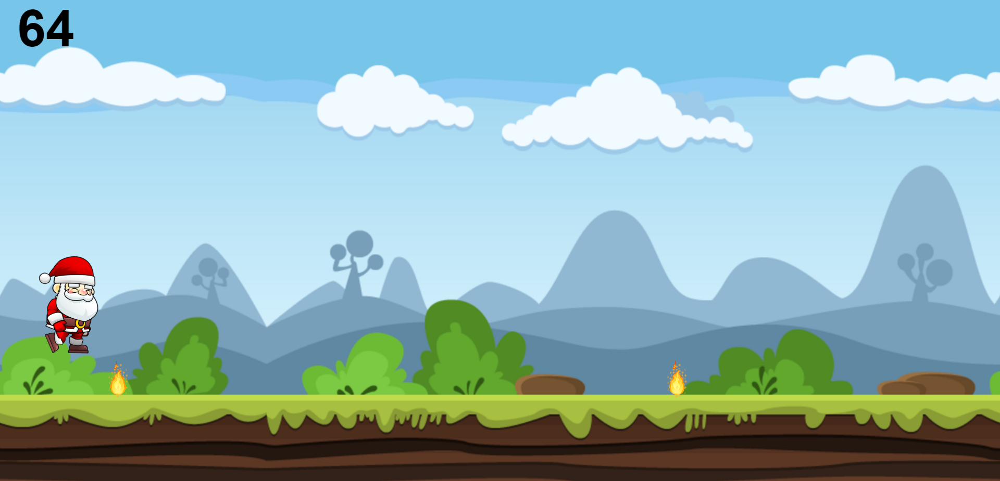
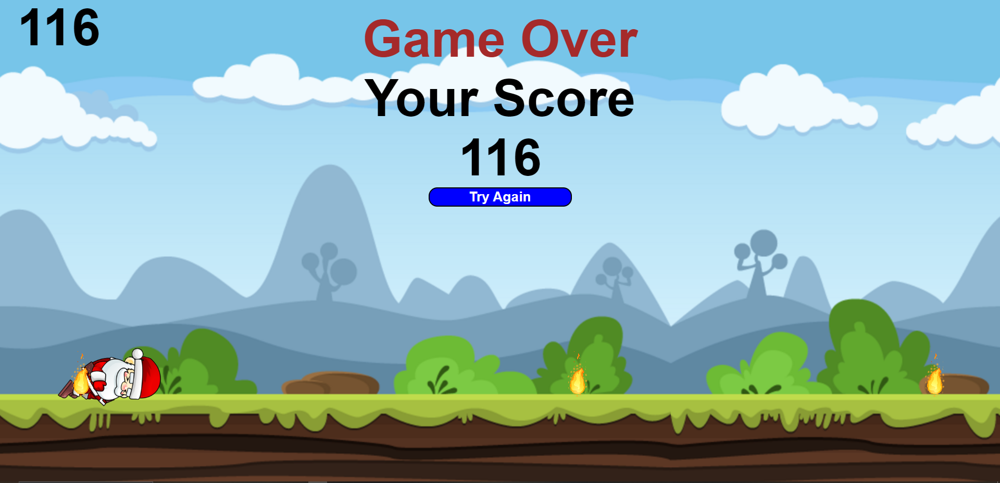

# Santa Run

> A festive endless runner game built with vanilla HTML5, CSS3, and JavaScript. Help Santa dodge flames and deliver presents!

[](https://opensource.org/licenses/MIT)
[](https://developer.mozilla.org/en-US/docs/Web/HTML)
[](https://developer.mozilla.org/en-US/docs/Web/CSS)
[](https://developer.mozilla.org/en-US/docs/Web/JavaScript)
[](https://vanilla-js.com/)
[]()

---

## 🎮 Demo

### Play Online

👉 **[Play Santa Run on GitHub Pages](https://dhanikaj.github.io/Santa-Run/)**

### Screenshots

|                  Gameplay                  |                  Game Over                  |
| :----------------------------------------: | :-----------------------------------------: |
|  |  |

---

## ✨ Features

- 🎅 **Animated Santa Character** — Smooth sprite-based animations for idle, running, jumping, and death states
- 🔥 **Dynamic Obstacles** — Flame blocks spawn at random intervals with varying gaps
- 🌌 **Parallax Background** — Infinite scrolling background for immersive gameplay
- 📊 **Real-time Score** — Live score counter that increases as you survive
- 🔊 **Sound Effects** — Audio feedback for running, jumping, and game over
- 🔄 **Restart Functionality** — One-click restart after game over
- ⌨️ **Simple Controls** — Enter to start, Space to jump
- 📱 **Responsive Design** — Works on desktop and mobile browsers
- 🚀 **Zero Dependencies** — Pure vanilla JavaScript, no build step required

---

## 🎯 How to Play

| Key     | Action               |
| ------- | -------------------- |
| `Enter` | Start / Restart Game |
| `Space` | Jump (while running) |

1. Press **Enter** to start the game
2. Santa will begin running automatically
3. Press **Space** to jump over flame obstacles
4. Survive as long as possible to increase your score
5. Hit a flame → Game Over
6. Press **Enter** or click **"Try Again"** to restart

---

## 🛠️ Tech Stack

| Category       | Technology                    |
| -------------- | ----------------------------- |
| **Markup**     | HTML5                         |
| **Styling**    | CSS3 (Flexbox, CSS Variables) |
| **Logic**      | Vanilla JavaScript (ES5+)     |
| **Audio**      | HTML5 Audio API               |
| **Graphics**   | Sprite Sheets (PNG) + GIF     |
| **Deployment** | Static Hosting (GitHub Pages) |
| **Paradigm**   | Single-file DOM manipulation  |

---

## 📁 Project Structure

```text
Santa Run/
├── index.html           # Main HTML entry point
├── script.js            # Game logic (~170 lines, single file)
├── style.css            # Styling and layout
├── .gitattributes       # Git line-ending normalization
├── run.mp3              # Running sound effect (looped, 35.5 KB)
├── jump.mp3             # Jump sound effect (5.0 KB)
├── dead.mp3             # Game over sound effect (25.9 KB)
└── images/
    ├── background.png    # Scrolling background (166 KB)
    ├── flame.gif         # Animated flame obstacle (1.3 MB)
    ├── Idle (1-16).png   # Santa idle animation — 16 frames
    ├── Run (1-11).png    # Santa running animation — 11 frames
    ├── Jump (1-16).png   # Santa jumping animation — 16 frames
    └── Dead (1-17).png   # Santa death animation — 17 frames
```

---

## 🚀 Quick Start

### Prerequisites

- A modern web browser (Chrome 60+, Firefox 55+, Safari 11+, Edge 79+)
- No Node.js, npm, or build tools required

### Local Development

```bash
# Clone the repository
git clone https://github.com/DhanikaJ/Santa-Run.git
cd Santa-Run

# Option 1: Open directly in browser
open index.html        # macOS
start index.html       # Windows
xdg-open index.html    # Linux

# Option 2: Serve with a local server (recommended for audio)
npx serve .            # Requires Node.js
# OR
python -m http.server 8000
# Then open http://localhost:8000
```

> ⚠️ **Note:** Audio may not play when opening `index.html` directly via `file://` protocol due to browser security policies. Use a local server for full audio support.

---

## 🏗️ Game Architecture

### Core Game Loop

The game uses `setInterval` timers (100ms tick rate) for each subsystem:

| Timer                | Interval | Purpose                              |
| -------------------- | -------- | ------------------------------------ |
| `runWorkerId`        | 100ms    | Santa running animation              |
| `jumpWorkerId`       | 100ms    | Jump physics & animation             |
| `backgroundWorkerId` | 100ms    | Background parallax scrolling        |
| `scoreWorkerId`      | 100ms    | Score increment                      |
| `createBlockId`      | 100ms    | Spawn new flame obstacles            |
| `moveBlockId`        | 100ms    | Move obstacles + collision detection |
| `deadWorkerId`       | 100ms    | Death animation sequence             |

### Game States

```text
┌──────┐    Enter    ┌────────┐   Space    ┌───────┐
│ Idle │ ───────────→ │ Running │ ─────────→ │ Jumping │
└──────┘             └─────────┘            └───────┘
                          │  Collision
                          ▼
                     ┌────────┐
                     │ Dead   │ ───→ Game Over Screen
                     └────────┘
```

- **Idle** — Waiting for Enter key (initial state)
- **Running** — Santa runs, obstacles spawn, score increases
- **Jumping** — Physics-based arc: 9 frames up (−20px/f), 8 frames down (+20px/f)
- **Dead** — Death animation plays, game over screen shows with final score

### Collision Detection

Simple AABB (Axis-Aligned Bounding Box) collision between Santa and flame blocks:

```javascript
// Block moves left at 20px per tick
// Collision zone: block marginLeft between 18px–118px (Santa's X range)
//                AND Santa's marginTop between 520px–580px (ground level)
if (newMarginLeft <= 118 && newMarginLeft >= 18) {
  if (santaMarginTop <= 580 && santaMarginTop > 520) {
    // Collision! → Trigger game over
  }
}
```

---

## 🐛 Known Issues

- Audio may not play on `file://` protocol (use local server)
- No high score persistence (resets on page refresh)
- No mobile touch controls (keyboard only)
- Collision detection is basic AABB (no per-pixel accuracy)
- No pause/resume functionality
- Single-file architecture (no modularity)

---

<div align="center">

**Made with ❤️ and 🎄 holiday spirit**

[Play Now](https://dhanikaj.github.io/Santa-Run/)

</div>
